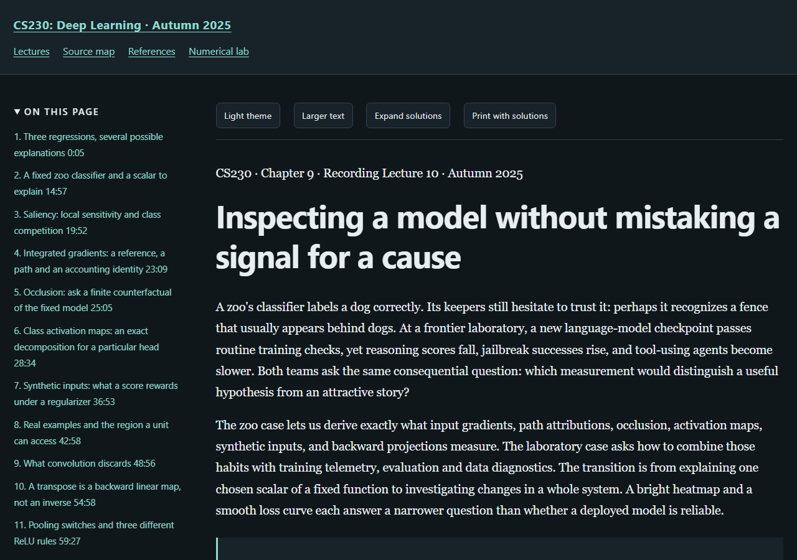

# Stanford CS230: Deep Learning, Autumn 2025

An independently written study book following nine Stanford recordings. The course recordings determine the topic order; the explanations, derivations, finite programs and worked exercises are educational additions.

[Read the online textbook](https://az9713.github.io/cs230-deep-learning-notes/) · [Source and timestamp map](https://az9713.github.io/cs230-deep-learning-notes/source-map.html) · [Primary references](https://az9713.github.io/cs230-deep-learning-notes/references.html) · [Numerical laboratory](https://az9713.github.io/cs230-deep-learning-notes/numerical-lab.html)

[Official course page](https://cs230.stanford.edu/) · [Recording playlist](https://www.youtube.com/playlist?list=PLoROMvodv4rNRRGdS0rBbXOUGA0wjdh1X)

Nine chapters contain 53 complete worked solutions and nine executable chapter examples, with a cumulative laboratory. Learning curves, supervision, the project cycle, adversarial and generative models, reinforcement learning, project strategy, agents, career decisions and model interpretation.



## Read the chapters online

| Book chapter | Live chapter | Stanford recording |
|---:|---|---|
| 1 | [Learning curves, capacity, and the decision to collect more data](https://az9713.github.io/cs230-deep-learning-notes/lecture-01-introduction-to-deep-learning.html) | [Recording 1](https://www.youtube.com/watch?v=_NLHFoVNlbg) |
| 2 | [Where supervision comes from, and what the loss makes of it](https://az9713.github.io/cs230-deep-learning-notes/lecture-02-supervised-self-supervised-and-weakly-supervised-learning.html) | [Recording 2](https://www.youtube.com/watch?v=DNCn1BpCAUY) |
| 3 | [The full cycle of a deep-learning project: from the first dataset to a monitored system](https://az9713.github.io/cs230-deep-learning-notes/lecture-03-full-cycle-of-a-deep-learning-project.html) | [Recording 3](https://www.youtube.com/watch?v=MGqQuQEUXhk) |
| 4 | [Attacking a fixed network, and training a network to generate](https://az9713.github.io/cs230-deep-learning-notes/lecture-04-adversarial-robustness-and-generative-models.html) | [Recording 4](https://www.youtube.com/watch?v=aWlRtOlacYM) |
| 5 | [Learning which actions are good from a delayed reward](https://az9713.github.io/cs230-deep-learning-notes/lecture-05-deep-reinforcement-learning.html) | [Recording 5](https://www.youtube.com/watch?v=4E27qlfYw0A) |
| 6 | [Deciding what to try next when a learned system fails](https://az9713.github.io/cs230-deep-learning-notes/lecture-06-ai-project-strategy.html) | [Recording 6](https://www.youtube.com/watch?v=s6JVGzABKho) |
| 7 | [Building a reliable application around a frozen language model](https://az9713.github.io/cs230-deep-learning-notes/lecture-07-agents-prompts-and-rag.html) | [Recording 8](https://www.youtube.com/watch?v=k1njvbBmfsw) |
| 8 | [Building a career by showing useful work](https://az9713.github.io/cs230-deep-learning-notes/lecture-08-career-advice-in-ai.html) | [Recording 9](https://www.youtube.com/watch?v=AuZoDsNmG_s) |
| 9 | [Inspecting a model without mistaking a signal for a cause](https://az9713.github.io/cs230-deep-learning-notes/lecture-09-whats-going-on-inside-my-model.html) | [Recording 10](https://www.youtube.com/watch?v=Ozb1AR_F5MU) |

## What the book adds

Each chapter develops assumptions, notation, derivations, interpretations, limitations and exercises around its recording. Timestamp links locate the related discussion. The source map distinguishes lecture material, primary research and original teaching constructions; research claims retain their source versions and experimental conditions.

## Validation and remaining limits

All nine chapters and the book-wide manuscript passed independent editorial review within the recorded scopes. Local validation covers source identity, executable examples and displayed output, reader controls, links, mathematical rendering, desktop/mobile layouts and public-file privacy. The actual validation records state their scope and artifact hashes:

- [Validation summary](validation-summary.json)
- [Reader checks](reader-validation.json)

Some Chapter 7 originals remain unavailable through the recorded acquisition routes (McKinsey timeout, Cohen publisher/institutional HTTP/TLS failures, Victor/NYT HTTP 403). The chapters retain bounded attribution and distinguish inspected material from unavailable originals. The human keyboard and screen-reader audit is not performed. Full accessibility certification remains pending. Publication is authorized separately and does not imply those outstanding checks were performed.

Transcript hashes and timing checks establish file identity and valid intervals; they do not establish human-verified speech recognition. The finite programs do not reproduce large model or GPU benchmarks. Speaker opinions, company reports, empirical observations and formal results retain distinct evidence grades.

## Attribution and source boundaries

This is an independent educational contribution. Stanford supplies the course recordings and their intellectual context; cited research is attributed to its original creators. This repository is not an official Stanford publication or endorsement. It links to recordings and papers. Raw media, machine transcripts, acquired paper/deck copies, private acquisition logs and editorial working files are excluded.

## Use locally

Download this repository and open `index.html`, or serve the directory with `python -m http.server 8000 --bind 127.0.0.1`. The bundled reader and mathematics work offline; external recording and research links require internet access.

The cumulative laboratory uses Python's standard library. Some embedded chapter examples additionally require NumPy, listed in `requirements.txt`.

```sh
python numerical_lab.py
```

GitHub Pages serves the `main` branch root. `.nojekyll` keeps this a static HTML package. The bundled MathJax license is in `assets/mathjax-LICENSE`.
